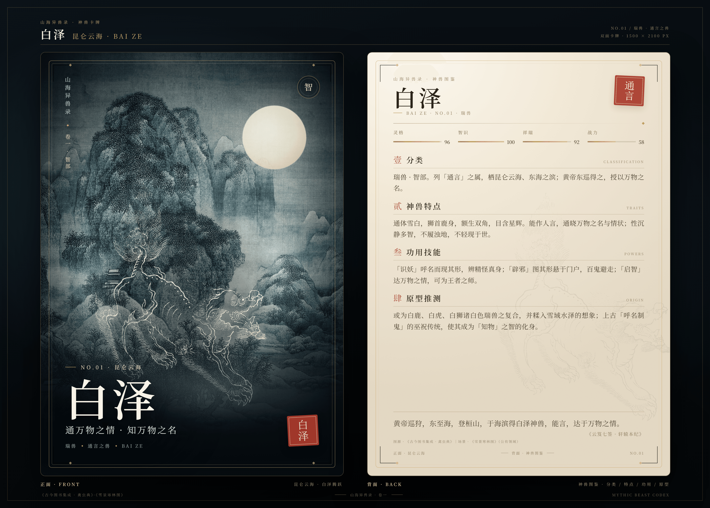
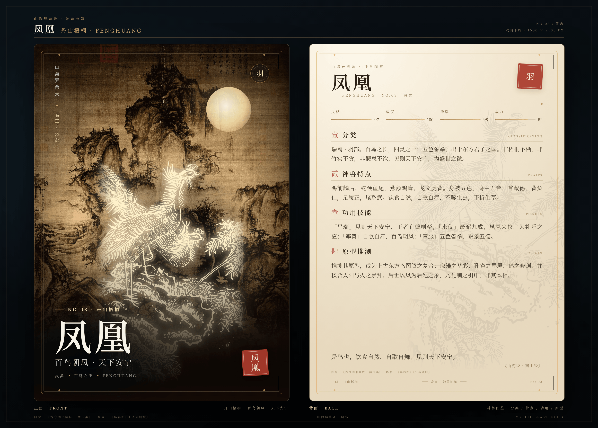

# 山海异兽录 · 十一神兽卡牌

白泽、麒麟、凤凰、玄武、朱雀、重明鸟、白虎、乘黄、青龙、貔貅、九尾狐，共十一张正反双面的神兽卡牌。正面为神兽姿态与所居山水，背面为分类、神兽特点、功用技能与原型推测。每张卡牌都提供单面 PNG 与包含正反两面的合成渲染图。





全部卡牌可在 [`cards/index.html`](cards/index.html) 中浏览。

## 卡牌一览

| No. | 神兽 | 卷部 | 正面场景 | 单面尺寸 | 双面合成 |
| --- | --- | --- | --- | --- | --- |
| 01 | 白泽 | 卷一 · 智部 | 昆仑云海 | 1500 × 2100 px | 3520 × 2520 px |
| 02 | 麒麟 | 卷二 · 仁部 | 青绿山川 | 1500 × 2100 px | 3520 × 2520 px |
| 03 | 凤凰 | 卷三 · 羽部 | 丹山梧桐 | 1500 × 2100 px | 3520 × 2520 px |
| 04 | 玄武 | 卷四 · 四象 | 北溟玄水 | 1500 × 2100 px | 3520 × 2520 px |
| 05 | 朱雀 | 卷三 · 羽部 | 南陆赤霄 | 1500 × 2100 px | 3520 × 2520 px |
| 06 | 重明鸟 | 卷三 · 羽部 | 尧都朝阳 | 1500 × 2100 px | 3520 × 2520 px |
| 07 | 白虎 | 卷四 · 四象 | 西极白霜 | 1500 × 2100 px | 3520 × 2520 px |
| 08 | 乘黄 | 卷五 · 异兽 | 白民之野 | 1500 × 2100 px | 3520 × 2520 px |
| 09 | 青龙 | 卷四 · 四象 | 东皋青野 | 1500 × 2100 px | 3520 × 2520 px |
| 10 | 貔貅 | 卷五 · 异兽 | 雪岭金关 | 1500 × 2100 px | 3520 × 2520 px |
| 11 | 九尾狐 | 卷五 · 异兽 | 青丘月林 | 1500 × 2100 px | 3520 × 2520 px |

## 卡牌内容

### 白泽 · 昆仑云海

- **分类**：瑞兽 · 智部。列「通言」之属，栖昆仑云海、东海之滨；黄帝东巡得之，授以万物之名。
- **神兽特点**：通体雪白，狮首鹿身，额生双角，目含星辉。能作人言，通晓万物之名与情状；性沉静多智，不履浊地，不轻现于世。
- **功用技能**：「识妖」呼名而现其形，辨精怪真身；「辟邪」图其形悬于门户，百鬼避走；「启智」达万物之情，可为王者之师。
- **原型推测**：或为白鹿、白虎、白狮诸白色瑞兽之复合，并糅入雪域水泽的想象；上古「呼名制鬼」的巫祝传统，使其成为「知物」之智的化身。
- **引文**：黄帝巡狩，东至海，登桓山，于海滨得白泽神兽，能言，达于万物之情。——《云笈七签 · 轩辕本纪》

### 麒麟 · 青绿山川

- **分类**：瑞兽 · 仁部。列「四灵」之一，与凤、龟、龙并称；盛世则现，王者有德则至，栖青山碧水之间。
- **神兽特点**：麋身牛尾，马蹄一角，角端有肉；身被龙鳞，足不履虫，不折生草，不饮污池。行步中规，声合中吕，性至仁而不伤物。
- **功用技能**：「兆瑞」天下太平则现身；「送子」麟趾呈祥，祈子嗣贤昌；「章服」明清补服取为章纹，表爵禄与勇德；「镇宅」置形于门，纳福辟邪。
- **原型推测**：当为鹿、牛、马与龙图腾之复合：取鹿角之柔、牛尾之韧、马蹄之健、龙鳞之贵。明代以长颈鹿附会「麒麟」，乃后起误认，非其原型。
- **引文**：麒，仁兽也。麋身，牛尾，一角。——《说文解字》

### 凤凰 · 丹山梧桐

- **分类**：瑞禽 · 羽部。百鸟之长，四灵之一；五色备举，出于东方君子之国。非梧桐不栖，非竹实不食，非醴泉不饮，见则天下安宁，为盛世之徵。
- **神兽特点**：鸿前麟后，蛇颈鱼尾，燕颔鸡喙，龙文虎背。身被五色，鸣中五音；首戴德，背负仁，足履正，尾系武。饮食自然，自歌自舞，不啄生虫，不折生草。
- **功用技能**：「呈瑞」见则天下安宁，王者有德则至；「来仪」箫韶九成，凤凰来仪，为礼乐之应；「率舞」自歌自舞，百鸟朝凤；「章服」五色备举，取象五德。
- **原型推测**：推测其原型，或为上古东方鸟图腾之复合：取雉之华彩、孔雀之尾屏、鹤之修颈，并糅合太阳与火之崇拜。后世以凤为后妃之象，乃礼制之引申，非其本相。
- **引文**：是鸟也，饮食自然，自歌自舞，见则天下安宁。——《山海经 · 南山经》

### 玄武 · 北溟玄水

- **分类**：四象之一，北方之神，主水德，镇守北陆。位当斗、牛、女、虚、危、室、壁七宿，龟蛇相缠，谓之玄武。后世奉为真武、玄天上帝，专司荡魔护国。
- **神兽特点**：龟蛇合体，玄甲覆背，蛇尾盘绕；目如寒潭，行则水随。性沉静而善守，不轻动，动则江河随之。冬藏而不竞春，故主北方长久之运。
- **功用技能**：「镇北」坐镇玄天，压伏江河之患；「司水」调四时雨雪，主冬藏闭蓄；「荡魔」真武仗剑，扫荡邪祟；「护舟」佑涉江海者，风波不惊。
- **原型推测**：推测由北方水神、龟蛇图腾与二十八宿之北方星象叠合而成；龟主长久，蛇主灵动，合为一象。宋人避讳改称真武，遂由星神衍为道教人格大神。
- **引文**：北宫玄武，虚、危。——《史记 · 天官书》

### 朱雀 · 南陆赤霄

- **分类**：灵禽 · 羽部。四象之一，南方之灵，为火之精，非凤凰之别名。天之四灵，以正四方；配南宫朱鸟，领井、鬼、柳、星、张、翼、轸七宿，主夏气与荧惑。
- **神兽特点**：赤羽丹喙，鸡冠燕颔，蛇颈鱼尾；振翼则火光流天，目如丹砂。性烈而正，司南方之生气，鸣中徵音；不栖凡木，不饮浊泉。
- **功用技能**：「司南」主南方七宿，正四时之序；「布火」振翼流火，照彻幽阴；「司夏」应荧惑之行，主生长与礼；「镇邪」悬象南宫，以正四方，百邪不敢犯。
- **原型推测**：推测其原型，或为上古南方鸟图腾与星象之合：先民观南宫七宿，连缀如鸟，遂以赤鸟名之；又糅入火神祝融之祀。其与凤凰形近而源异，不可混为一物。
- **引文**：南方火也，其帝炎帝，其佐朱明，执衡而治夏；其神为荧惑，其兽朱鸟。——《淮南子 · 天文训》

### 重明鸟 · 尧都朝阳

- **分类**：瑞禽 · 羽部。状如鸡，鸣如凤，目有双睛，故名重明。尧在位七十年，祗支之国献之；能搏逐猛兽，辟除妖灾，后世画鸡于户即其遗俗。
- **神兽特点**：形似鸡而略大，双睛炯炯，羽毛鲜明；鸣声清亮如凤，振翅则群兽辟易。性刚烈而护人，见妖魅则搏而逐之，不容于户庭。
- **功用技能**：「辟邪」悬其形于门户，魑魅退伏；「逐兽」搏击虎狼，护佑村邑；「献瑞」尧时来朝，为太平之应；「画鸡」元旦绘于户牖，遂为岁首之俗。
- **原型推测**：推测其原型，或为上古东方雉类神鸟之夸饰：取雄鸡之形、凤鸟之鸣，附以双瞳之异，遂成能逐兽辟邪之瑞禽。尧时献瑞之说，当为后起之附会。
- **引文**：献重明之鸟，一名双睛，言双睛在目，状如鸡，鸣似凤。——《拾遗记 · 卷一》

### 白虎 · 西极白霜

- **分类**：四象之一，西方之神，主金德，司秋杀。位当奎、娄、胃、昴、毕、觜、参七宿，其形如虎，主兵戈刑威。非山中白化之虎，乃西宫星象之神。
- **神兽特点**：虎形而白，通体如雪，黑纹隐现，目若金灯，爪如寒钩；踞则风生，啸则谷应。性刚而肃，主杀伐而不妄噬；乘秋气而出，为护军之旗。
- **功用技能**：「肃杀」乘秋气而行，摧枯折腐；「主兵」虎符调军，旗号白虎，三军肃然；「辟邪」悬形于门，魑魅退避；「武威」啸震山林，百兽慑伏，风为之起。
- **原型推测**：推测由西方七宿的虎形连缀而起，参、觜诸宿最肖虎体；又与西极金气、秋令肃杀相配。后世取其武威，用为军旗、兵符与镇宅之象，遂成西方白虎之形。
- **引文**：西方，金也，其帝少昊，其佐蓐收，执矩而治秋。其神为太白，其兽白虎。——《淮南子 · 天文训》

### 乘黄 · 白民之野

- **分类**：瑞兽 · 寿部。出《山海经 · 海外西经》白民之国，状如狐而背有角，乘之者寿二千岁；又号「飞黄」，世传黄帝尝乘之，后世遂以之名良马。
- **神兽特点**：其状如狐，毛色如金，背脊生角，行则有光；性驯而不噬，饮露栖霞，不践秽土，不履生草。出则天下安宁，乘之则延年却老。
- **功用技能**：「延寿」乘之者寿二千岁，却老还童；「兆瑞」圣王受命则出于西荒，世以为长生之征；「代步」后世以飞黄名御马，喻腾达青云。
- **原型推测**：原型当为沙狐、鹿、马之复合：狐形取其轻捷，背角取鹿，寿数寄长生之想；「飞黄」之名后起，遂由西荒瑞兽转为良马之称。推测如此，非定论。
- **引文**：有乘黄，其状如狐，其背上有角，乘之寿二千岁。——《山海经 · 海外西经》

### 青龙 · 东皋青野

- **分类**：四象之首，东方之神，主木德，司春生。位当角、亢、氐、房、心、尾、箕七宿，角亢为龙角，苍龙抬头，万物萌动。非世间鳞虫之龙，乃天象之龙。
- **神兽特点**：龙角峥嵘，鳞甲皆青，身缠青气，五爪不著地。春分则角宿东升，谓之龙抬头；秋分西沉，隐于渊。性生发而好施，见则草木蕃、岁谷登。
- **功用技能**：「司春」角宿东升，启蛰催耕；「生发」布木德于草木，枯者复荣；「致雨」兴云布雨，泽及万顷田畴；「兆瑞」见则天下安宁，五谷丰登。
- **原型推测**：推测源于东方苍龙七宿的星象连缀：先民以角、亢至尾、箕诸宿拟作龙形，复与东方木神、春生之德相合。其形后为帝王所专，然本源仍是天象，非任意之龙。
- **引文**：前朱鸟而后玄武，左青龙而右白虎。——《礼记 · 曲礼上》

### 貔貅 · 雪岭金关

- **分类**：猛兽 · 财部。古单称「貔」，《说文》谓豹属猛兽，《诗》有「献其貔皮」之贡；后世合称「貔貅」，狮首独角，主辟邪守财，列于门阙库藏之间。
- **神兽特点**：狮首独角，身被鳞甲，腹巨口阔；俗传有口无肛，纳金银珠玉而不泄。性狞猛，善守而能却鬼魅，故人多置之库藏门阙以镇宅。
- **功用技能**：「辟邪」悬像门阙，百鬼辟易，邪祟不敢近；「聚财」纳四方之财而不出，商贾奉为财神；「镇库」守库藏、压宅基；「励勇」古以貔貅名猛士，旌旗取之。
- **原型推测**：「貔」古义本歧：《说文》谓豹属，旧注谓虎属，《尔雅》又谓白狐；后世取狮子之形，增独角鳞甲，遂成今貌。聚财之说乃明清民俗增饰，非古义。推测如此，未可遽定。
- **引文**：献其貔皮，赤豹黄罴。——《诗经 · 大雅 · 韩奕》

### 九尾狐 · 青丘月林

- **分类**：妖兽 · 魅部。出《山海经 · 南山经》青丘之山，其阳多玉，状如狐而九尾，音如婴儿，能食人；汉世又以九尾为子孙繁息、王德所感之瑞。
- **神兽特点**：狐身九尾，尾大如云，毛色或白如霜雪，或赤若丹砂；目含媚光，声若婴儿夜啼。性黠多疑，能幻人形，出入人家而不畏人。
- **功用技能**：「媚惑」幻作美人，乱人心志；「食人」以婴儿之音诱人而啖之；「兆瑞」白狐九尾见于涂山，应夏禹之兴；「通幽」《说文》称妖兽、鬼所乘，巫祝资以事神。
- **原型推测**：原型或为赤狐、白狐之夸饰：九尾取「九」为极数，寓多子与王德；禹娶涂山女之说，使其由食人之兽转为兴国之瑞，六朝志怪又复归妖异。推测如此，非定论。
- **引文**：有兽焉，其状如狐而九尾，其音如婴儿，能食人，食者不蛊。——《山海经 · 南山经》

## 文件结构

```
cards/
  index.html            卡牌画廊（本地打开即可浏览）
  data/beasts.json      十一张卡牌的内容与视觉配置
  baize-front.html      白泽正面（750 × 1050 设计稿）
  baize-back.html       白泽背面
  ...                   其余十张同构
  present-<id>.html     各神兽正反双面展示页（3520 × 2520 渲染源）
  card.css              卡面样式
  grain.svg             纸纹
  assets/               背景、神兽线描、遮罩资源
  renders/              最终渲染 PNG
tools/
  build_cards.py        由数据生成九张新卡面与画廊
  render.ps1            用无头 Edge / Chrome 重新渲染全部 PNG
docs/evidence/          Before / After 视觉证据
ATTRIBUTION.md          图像来源与公有领域说明
```

## 重新渲染

需要 Windows 上的 Microsoft Edge 或 Google Chrome：

```powershell
powershell -ExecutionPolicy Bypass -File tools/render.ps1
```

只渲染某几张时使用 `-Only`：

```powershell
powershell -ExecutionPolicy Bypass -File tools/render.ps1 -Only fenghuang-front,xuanwu-card
```

`render.ps1` 输出：

- `cards/renders/<id>-front.png`、`<id>-back.png`（各 1500 × 2100）
- `cards/renders/<id>-card.png`（各 3520 × 2520，正反两面）

## 图像来源

神兽线描取自《古今图书集成 · 禽虫典》中的白泽、麒麟、凤凰、鸾鸟、鵔鸟、虎、貔、九尾狐、乘黄、龙、龟、青蛇诸图（公有领域，Wikimedia Commons），经重新设色与局部遮罩；山水背景取自《雪景寒林图》、王希孟《千里江山图》、郭熙《早春图》、范宽《溪山行旅图》局部（均为公有领域），经裁切与调色。完整来源与链接见 [ATTRIBUTION.md](ATTRIBUTION.md)。

朱雀、重明鸟、白虎、青龙、貔貅分别以同书中的鸾鸟、鵔鸟、虎、龙、貔图作为形象参照；玄武由龟图与青蛇图合绘。卡面为艺术再设计，不声称与古籍原图逐一对应。

卡面排版、构图、配色与文案为本仓库新增内容。

## 说明

- 卡面以 CSS 尺寸 750 × 1050（5:7）设计，2 倍缩放输出 1500 × 2100 PNG。
- 正反合成图包含两面的完整图像、卡牌投影与编号标签。
- 文字内容参考《山海经》《云笈七签》《说文解字》《礼记》《淮南子》《拾遗记》等传世文献；「原型推测」为编者按，不作学术定论。
- 仓库中的 `renders/` 为便于审阅的压缩 PNG；重新运行 `render.ps1` 可得到未压缩版本。
