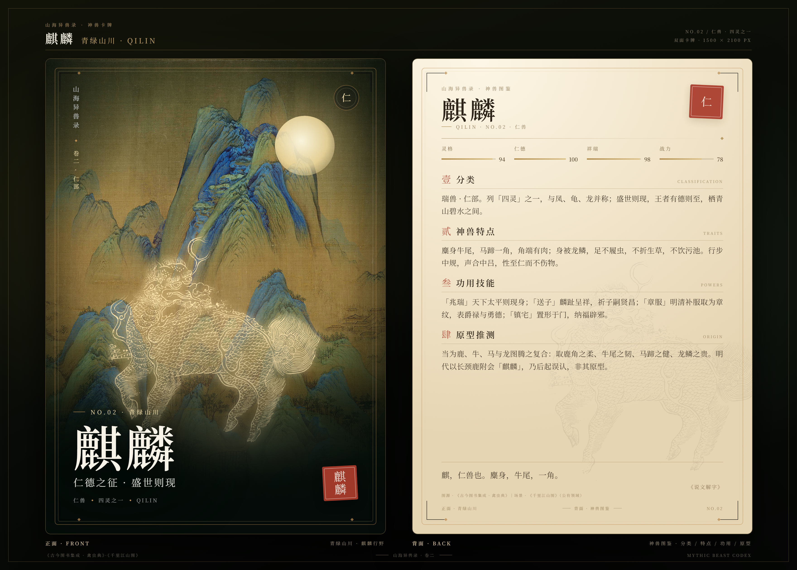

# 山海异兽录 · 白泽 & 麒麟神兽卡牌

两张正反双面的神兽卡牌：**白泽**与**麒麟**。正面是神兽的姿态与所居山水，背面是神兽分类、特点、功用技能与原型推测。每张卡牌都提供单面 PNG 与包含正反两面的合成渲染图。




## 卡牌一览

| No. | 神兽 | 正面场景 | 背面 | 单面尺寸 | 双面合成 |
| --- | --- | --- | --- | --- | --- |
| 01 | 白泽 | 昆仑云海 · 雪景寒林 | 智部 · 通言之兽 | 1500 × 2100 px | 3520 × 2520 px |
| 02 | 麒麟 | 青绿山川 · 千里江山 | 仁部 · 四灵之一 | 1500 × 2100 px | 3520 × 2520 px |

## 卡牌内容

### 白泽 · 昆仑云海

- **分类**：瑞兽 · 智部。列「通言」之属，栖昆仑云海、东海之滨；黄帝东巡得之，授以万物之名。
- **神兽特点**：通体雪白，狮首鹿身，额生双角，目含星辉。能作人言，通晓万物之名与情状；性沉静多智，不履浊地，不轻现于世。
- **功用技能**：「识妖」呼名而现其形，辨精怪真身；「辟邪」图其形悬于门户，百鬼避走；「启智」达万物之情，可为王者之师。
- **原型推测**：或为白鹿、白虎、白狮诸白色瑞兽之复合，并糅入雪域水泽的想象；上古「呼名制鬼」的巫祝传统，使其成为「知物」之智的化身。
- **引文**：黄帝巡狩，东至海，登桓山，于海滨得白泽神兽，能言，达于万物之情。——《云笈七签 · 轩辕本纪》

### 麒麟 · 青绿山川

- **分类**：瑞兽 · 仁部。列「四灵」之一，与凤、龟、龙并称；盛世则现，王者有德则至，栖青山碧水之间。
- **神兽特点**：麋身牛尾，马蹄一角，角端有肉；身被龙鳞，足不履虫，不折生草，不饮污池。行步中规，声合中吕，性至仁而不伤物。
- **功用技能**：「兆瑞」天下太平则现身；「送子」麟趾呈祥，祈子嗣贤昌；「章服」明清补服取为章纹，表爵禄与勇德；「镇宅」置形于门，纳福辟邪。
- **原型推测**：当为鹿、牛、马与龙图腾之复合：取鹿角之柔、牛尾之韧、马蹄之健、龙鳞之贵。明代以长颈鹿附会「麒麟」，乃后起误认，非其原型。
- **引文**：麒，仁兽也。麋身，牛尾，一角。——《说文解字》

## 文件结构

```
cards/
  index.html            卡牌画廊（本地打开即可浏览）
  baize-front.html      白泽正面（750 × 1050 设计稿）
  baize-back.html       白泽背面
  qilin-front.html      麒麟正面
  qilin-back.html       麒麟背面
  present-baize.html    白泽正反双面展示页（3520 × 2520 渲染源）
  present-qilin.html    麒麟正反双面展示页
  card.css              卡面样式
  grain.svg             纸纹
  assets/               背景、神兽线描、裁剪资源
  renders/              最终渲染 PNG
tools/
  render.ps1            用无头 Edge / Chrome 重新渲染全部 PNG
ATTRIBUTION.md          图像来源与公有领域说明
```

## 重新渲染

需要 Windows 上的 Microsoft Edge 或 Google Chrome：

```powershell
powershell -ExecutionPolicy Bypass -File tools/render.ps1
```

脚本会输出：

- `cards/renders/baize-front.png`、`baize-back.png`、`qilin-front.png`、`qilin-back.png`（各 1500 × 2100）
- `cards/renders/baize-card.png`、`qilin-card.png`（各 3520 × 2520，正反两面）

只渲染某几面时使用 `-Only`：

```powershell
powershell -ExecutionPolicy Bypass -File tools/render.ps1 -Only baize-front,qilin-back
```

## 图像来源

神兽线描取自《古今图书集成 · 禽虫典》中的白泽图、麒麟图（公有领域，Wikimedia Commons），经重新设色与局部遮罩；山水背景取自《雪景寒林图》与王希孟《千里江山图》局部（均为公有领域），经裁切与调色。完整来源与链接见 [ATTRIBUTION.md](ATTRIBUTION.md)。

卡面排版、构图、配色与文案为本仓库新增内容。

## 说明

- 卡面以 CSS 尺寸 750 × 1050（5:7）设计，2 倍缩放输出 1500 × 2100 PNG。
- 正反合成图包含两面的完整图像、卡牌投影与编号标签。
- 文字内容参考《云笈七签》《说文解字》《礼记》等传世文献，原型推测为编者按，不作学术定论。
